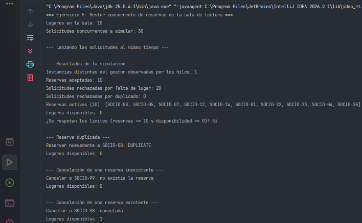

# Ejercicio 05 - Gestor Concurrente de Reservas de una Sala de Lectura

## Descripción

Una biblioteca tiene una sala de lectura con diez lugares. Varios puestos de atención, simulados mediante hilos, reciben solicitudes al mismo tiempo. Si cada puesto controla su propia disponibilidad, se aceptan más reservas que lugares existentes. Este ejercicio centraliza las reservas en un único gestor seguro ante concurrencia.

## Objetivos

- Implementar un Singleton seguro ante concurrencia.
- Proteger las operaciones sobre los cupos compartidos para que sean atómicas.
- Administrar diez lugares para una misma franja horaria, registrando reservas por identificador de socio.
- Rechazar reservas duplicadas o solicitudes cuando no quedan lugares.
- Cancelar reservas recuperando el lugar, sin liberar lugares si la reserva no existe.
- Simular al menos treinta solicitudes concurrentes de socios diferentes y verificar que las reservas nunca superen diez ni la disponibilidad sea negativa.

## Implementación del patrón Singleton

Se utiliza la variante **double-checked locking**:

- El atributo estático `instance` se declara `volatile` para garantizar la visibilidad de la instancia entre los hilos y evitar problemas de publicación durante su inicialización.
- La primera comprobación `if (instance == null)` se realiza sin bloqueo, evitando la sincronización innecesaria después de crear la instancia.
- La segunda comprobación se realiza dentro de un bloque `synchronized`, para garantizar que solo un hilo cree la instancia.
- El constructor es `private`, impidiendo crear instancias desde otras clases.

Las operaciones `reserve`, `cancel`, `getActiveReservations` y `getAvailableSeats` son `synchronized`. Esto protege el estado compartido y permite que la comprobación de disponibilidad y el registro de una reserva constituyan una única operación atómica.

## Propósito de las clases

- `ReadingRoomManager`: es el Singleton. Mantiene los socios con reserva activa, limita la capacidad a diez lugares y permite reservar, cancelar y consultar la disponibilidad.
- `ReservationResult`: enumeración que representa los resultados posibles de una reserva: aceptada, duplicada o sin lugares disponibles.
- `ReservationRequest`: tarea que implementa `Runnable` y simula un puesto de atención solicitando una reserva desde su propio hilo.
- `Main`: lanza treinta hilos coordinados mediante `CountDownLatch`, cuenta los resultados, comprueba los límites y prueba las reservas duplicadas y las cancelaciones.

## Concepto clave

Con varios hilos, un Singleton necesita dos protecciones: que **la creación de la instancia** sea segura (`volatile` y doble comprobación) y que **las operaciones sobre el estado compartido** sean atómicas (`synchronized`).

Si la comprobación del cupo y el registro de la reserva fueran pasos separados y sin sincronización, dos hilos podrían detectar el mismo lugar libre y ambos intentar ocuparlo. Al sincronizar la operación completa, el gestor evita superar la capacidad disponible.

## Resultado

La ejecución de prueba obtuvo los siguientes resultados:

- Solicitudes concurrentes: 30.
- Reservas aceptadas: 10.
- Solicitudes rechazadas por falta de lugar: 20.
- Instancias distintas del gestor observadas: 1.
- Lugares disponibles al finalizar las solicitudes iniciales: 0.
- Las comprobaciones de capacidad y disponibilidad se cumplieron.

Además, se comprobó que una reserva duplicada es rechazada, que cancelar una reserva inexistente no libera lugares y que cancelar una reserva existente permite asignar nuevamente el lugar.

## Conclusión

La implementación demuestra que el patrón Singleton puede centralizar un recurso compartido incluso cuando varios hilos realizan solicitudes simultáneamente. 
El uso de `volatile` y double-checked locking protege la creación de la instancia, mientras que `synchronized` evita condiciones de carrera sobre los cupos. Así, las reservas activas no superan los diez lugares disponibles.